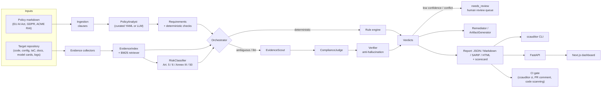

# Compliance-as-Code AI Auditor

Applied Machine Learning 2026-2027, topic #5. **Team:** Bâlc Felicia, Drăghici Eduard, Gog Raluca.

The auditor takes a **policy or regulation** (EU AI Act, GDPR, an internal Responsible-AI policy) and an
**application repository**, and produces an auditable compliance report that links **every requirement**
either to **evidence** (file + line range) or to a **gap**. Each report includes a scorecard per category,
the AI Act risk tier, remediation suggestions and a human-in-the-loop review queue. You can run it from
the CLI, call it through a REST API, browse results in a web dashboard, or use it as a
**compliance gate in CI/CD**: a pull request that removes an audit log or an AI disclosure fails the check.

There are three evaluation modes:

| Mode | How it decides | Needs |
|---|---|---|
| `deterministic` | YAML rule engine (regex/file/config checks) only. Fast, reproducible, free. | nothing |
| `llm` | LLM judge over BM25-retrieved evidence, with a verifier for every citation | Claude Code CLI |
| `hybrid` (default) | rules first; the LLM handles ambiguous or unknown cases; low confidence goes to `needs_review` | Claude Code CLI |

The LLM backend is the **Claude Code CLI in headless mode** (`claude -p --output-format json`) and runs on
the developer's Claude subscription, so **no API key is needed**.

## Architecture



For details (agents, data contracts, policy and requirement formats), see
[`docs/design/ARCHITECTURE.md`](docs/design/ARCHITECTURE.md).

## Repository layout

The course requires the application to live under `app/` and the documentation under `docs/`.

```
app/                       the application
├── backend/               Python package `ccauditor` (CLI, FastAPI, agents, rule engine, policies)
│   ├── ccauditor/         source; data/policies/*.md and data/requirements/*.yaml are bundled
│   ├── tests/             pytest suite (FakeBackend, so no LLM is needed)
│   ├── Dockerfile         container image of the API
│   └── index.py, vercel.json, requirements.txt   Vercel (serverless) entrypoint of the API
├── web/                   Next.js dashboard (audit form, policies, reports)
├── benchmark/             5 hand-labelled AI apps + ground truth + evaluate.py
└── notebooks/             EDA / results notebooks
docs/                      documentation
├── design/                architecture notes
└── report/                LaTeX report (report.tex)
scripts/demo_regression.sh CI regression demo
.github/workflows/         tests.yml (pytest + web lint/build), compliance.yml (compliance gate)
```

## Quickstart

Requirements: Python 3.11 or newer (3.12 recommended), Node 24 for the web app, and git.

```bash
python3 -m venv .venv && source .venv/bin/activate
pip install -e "app/backend[dev]"          # or: make install

ccauditor policies                          # built-in policies and requirement counts
ccauditor audit app/benchmark/apps/hireright-screening -p eu-ai-act -m deterministic
ccauditor audit app/benchmark/apps/hireright-screening -p eu-ai-act -p gdpr \
    -m deterministic -f json -o report.json # formats: md | json | sarif | html
```

### Hybrid / LLM mode (Claude Code CLI, no API key)

```bash
npm install -g @anthropic-ai/claude-code    # once
claude                                      # log in once with your Claude subscription (Pro/Max)
ccauditor audit app/benchmark/apps/hireright-screening -p eu-ai-act -m hybrid --model sonnet -f md -o report.md
```

LLM responses are cached under `~/.cache/ccauditor` (`CCAUDITOR_CACHE_DIR`; disable with
`CCAUDITOR_NO_CACHE=1`). Use `CCAUDITOR_BACKEND=fake` to force the offline fake backend.

### Other commands

```bash
ccauditor explain report.json AIA-REC-01                 # why a requirement got its verdict (evidence, gaps)
ccauditor artifacts report.json --kind risk_assessment --out drafts/            # LLM-drafted artefacts
ccauditor artifacts report.json --out drafts/ --offline  # all 4 kinds as templates, no LLM
#   kinds: technical_documentation | risk_assessment | transparency_notice | model_card
ccauditor review apply report.json reviews.json          # apply human-in-the-loop decisions
ccauditor diff-policy old.md new.md --report report.json # policy evolution: which requirements to re-audit
ccauditor ci <repo> --baseline base.json --fail-on high  # CI gate (see below)
```

### API and web dashboard

```bash
make api        # uvicorn ccauditor.api:app --reload --port 8000   (OpenAPI docs: http://localhost:8000/docs)
make web        # cd app/web && npm i && NEXT_PUBLIC_API_URL=http://localhost:8000 npm run dev  -> :3000
docker compose up --build    # both, in containers (the API runs in deterministic mode there)
```

Main endpoints: `GET /health`, `GET /policies`, `GET /policies/{id}`,
`POST /audit` (`{"repo_url": "https://github.com/owner/repo", "policies": ["eu-ai-act"], "mode": "deterministic"}`),
`POST /reports/compare`, `POST /reports/render?format=md|json|sarif|html`, `POST /reports/review`, `POST /policies/diff`.

## Compliance-as-Code in CI/CD

[`.github/workflows/compliance.yml`](.github/workflows/compliance.yml) runs on every pull request:

1. It installs `ccauditor` and checks out the PR **base** commit into a git worktree.
2. It audits `TARGET_DIR` (deterministic mode) on base and head with the same auditor version.
3. It runs `ccauditor ci --baseline base.json --base-ref <base> --fail-on high`. **The check fails if any
   high or critical requirement regresses**, for example when audit-log retention is cut below six
   months or a recruiter-facing AI disclosure is deleted.
4. It uploads SARIF to GitHub code scanning (the step is skipped without error when code scanning is not
   available, as in private classroom repos), uploads the JSON/Markdown/SARIF reports as artefacts, and
   posts or updates a sticky PR comment with the regression table.
5. An optional, non-blocking **hybrid** job runs the same comparison with the LLM when the repository
   secret `CLAUDE_CODE_OAUTH_TOKEN` exists. Create the token with `claude setup-token`; it uses your
   subscription, not an API key. Without the secret the job is skipped.

You can configure the workflow with repository variables: `CCAUDITOR_TARGET_DIR` (default
`app/benchmark/apps/hireright-screening`), `CCAUDITOR_POLICIES` (default `eu-ai-act acme-rai`),
`CCAUDITOR_FAIL_ON` (default `high`) and `CCAUDITOR_MODEL`. You can also start it manually with
workflow_dispatch inputs.

To see the gate fail locally, run:

```bash
scripts/demo_regression.sh      # or: make regression-demo
```

The script copies the demo app into a temporary git repo and audits it. It then commits a "PR" that removes
the decision-journal audit-logging calls, cuts the log retention from 400 to 30 days and deletes the AI
disclosure banner. `ccauditor ci` then exits 1 with:

```
REGRESSION [medium] ACME-01 compliant -> non_compliant (lost evidence: web/src/components/CandidateRanking.tsx)
REGRESSION [high] AIA-REC-02 compliant -> non_compliant (lost evidence: config/retention.yaml)
CI result: FAIL
```

To use the gate in another repository, copy the workflow and set `CCAUDITOR_TARGET_DIR=.`. The minimal
version is:

```bash
pip install "git+https://github.com/<owner>/<this-repo>#subdirectory=app/backend"
ccauditor audit base/ -p eu-ai-act -m deterministic -f json -o baseline.json
ccauditor ci . --baseline baseline.json --fail-on high --sarif ccauditor.sarif --markdown-summary summary.md
```

## Adding a policy or requirements

1. **Policy text:** add `app/backend/ccauditor/data/policies/<id>.md` with YAML front matter (`id`, `name`,
   `version`, `kind`, `source`). Use `## Art. N | Title` headings for articles and `### 1` headings for
   paragraphs. The clause ids then become `<id>/Art.N` and `<id>/Art.N(1)`.
2. **Curated requirements:** add `app/backend/ccauditor/data/requirements/<id>.yaml`:

   ```yaml
   policy_id: my-policy
   requirements:
     - id: MY-REC-01
       clause_ids: ["my-policy/Art.3(1)"]
       category: record_keeping        # see ccauditor/models.py Category
       title: Decisions are logged
       statement: Every model decision is logged with timestamp, input reference and output.
       applies_to: [high, limited, minimal]
       severity: high                   # critical | high | medium | low (drives --fail-on)
       evidence_queries: ["audit log decision", "logger.info prediction"]
       llm_guidance: Commented-out logging or TODOs do not count.
       checks:                          # optional deterministic checks
         - type: pattern
           kinds: [code]
           pattern: "(audit_log|logger\\.(info|warning)).*(predict|decision)"
           expect: present
   ```

3. Validate the corpus and run the tests: `python app/benchmark/validate_corpus.py && make test`.
4. You can also use an ad-hoc YAML without editing the package:
   `ccauditor audit <repo> -p my-policy -r my-requirements.yaml`. Without curated requirements, the
   PolicyAnalyst agent can decompose the policy text with the LLM.

## Benchmark and evaluation

`app/benchmark/` holds five small but realistic AI applications with hand-labelled ground truth (225
labels) for every curated requirement. See [`app/benchmark/README.md`](app/benchmark/README.md).

```bash
python app/benchmark/validate_corpus.py                                   # policies, YAML, regexes, labels
python app/benchmark/evaluate.py --out v0_baseline --modes deterministic  # no LLM
python app/benchmark/evaluate.py --out v0_baseline --modes deterministic,hybrid,llm --model sonnet
python app/benchmark/evaluate.py --out v1_improved --modes hybrid --model haiku --append
python app/benchmark/evaluate.py --summary-only                           # rebuild results/SUMMARY.md
make eval MODES=deterministic,hybrid MODEL=sonnet EVAL_OUT=my_run
```

Metrics include accuracy, macro-F1, gap-detection precision/recall, false-compliance rate, needs-review
rate, citation validity, latency and LLM cost. Results are written to `app/benchmark/results/`.

## Tests

```bash
make test                                   # pytest (FakeBackend) + corpus validation
cd app/backend && pytest -m live --run-live # real Claude Code CLI calls (needs `claude` login)
make lint                                   # web ESLint (+ ruff if installed)
```

## Deployment

**Docker:** run `docker build -t ccauditor-api app/backend && docker run -p 8000:8000 ccauditor-api`, or
`docker compose up --build` for the API and web together.

**Vercel:** create two projects from the same repository.

| Project | Root Directory | Framework preset | Environment variables |
|---|---|---|---|
| backend | `app/backend` | FastAPI / Python (auto-detected from `index.py`) | `CCAUDITOR_CORS_ORIGINS=https://<web>.vercel.app` (optional) |
| web | `app/web` | Next.js (auto-detected) | `NEXT_PUBLIC_API_URL=https://<backend>.vercel.app` |

On Vercel (`VERCEL=1`) the API always runs in deterministic mode, because no logged-in Claude Code CLI
exists there. It also disables `repo_path`. When `git` is missing, the API downloads GitHub repositories
as tarballs from `codeload.github.com`. Neither project needs `vercel build` or extra build settings.

## Contributing

See [CONTRIBUTING.md](CONTRIBUTING.md) for the branch and PR workflow and the commit conventions.
